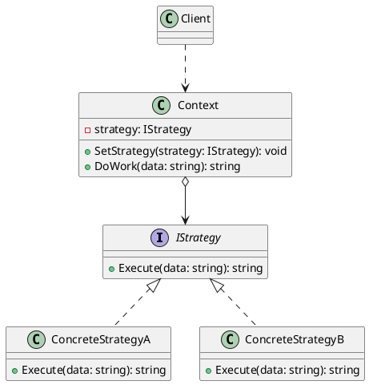
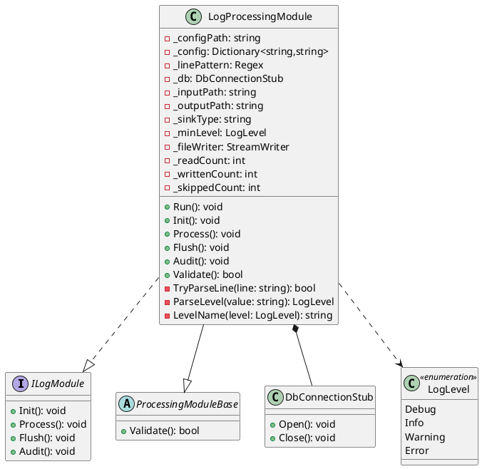
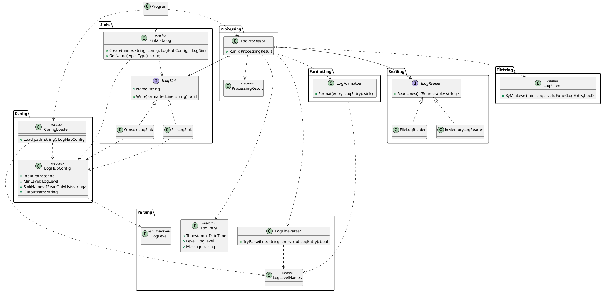

# Лабораторная работа 1. Git, среда и SOLID

**Студент:** Кабалов Илья Сергеевич, группа БИСО-01-24

**Вариант:** 17 — логи с несколькими кодировками (UTF-8, Windows-1251, KOI8-R); приёмники: файл, консоль

**Репозиторий:** https://github.com/ikgali/LogHub

**Pull Request:** <URL PR feature/лр-1>

## Задача

Я настраивал рабочий процесс для дальнейших лабораторных: две feature-ветки, solution с проектами приложения и тестов, GitHub Actions с зелёным бейджем. Затем я разобрал god-класс `LogProcessingModule`, нашёл в нём нарушения всех пяти принципов SOLID, разделил его на слои и покрыл разбор строки и маршрутизацию тестами. Отдельное требование — сохранить поведение программы: на одном и том же входном файле исходная и отрефакторенная версии должны давать одинаковый вывод и одинаковые счётчики.

## Часть 1. Репозиторий и среда

Работа ведётся в репозитории `ikgali/LogHub`. Ветка `develop` является основной для интеграции, от неё созданы две feature-ветки: `feature/лр-1-setup` с каркасом solution и CI и `feature/лр-1` с самой лабораторной. Прямых коммитов в `develop` я не делал: изменения попадают туда только через Pull Request. Ветка `main` и тег `v0.1.0` по заданию создаются вручную после приёмки, поэтому в текущем графе их ещё нет.

В корне лежит `LogHub.sln` с двумя проектами: `LogHub` (консольное приложение, `net10.0`, nullable и implicit usings включены) и `LogHubTests` (NUnit, `net10.0`). Сборка проверяется командой `dotnet build --no-incremental -warnaserror`, тесты — `dotnet test`. В `.gitignore` добавлены стандартные правила .NET, а также `data/out.log`; при этом файлы `data/sample-*.log` явно возвращены в индекс, потому что они являются тестовыми данными.

CI описан в `.github/workflows/build.yml`: на каждый push и pull request на `ubuntu-latest` выполняется restore, сборка в конфигурации Release с `-warnaserror` и тесты без повторной сборки. Бейдж сборки добавлен в `README.md`.

[SCREENSHOT: 01_remotes.png]
Рисунок 1 — Настроенные remote-репозитории и ветки

[SCREENSHOT: 02_ci_green.png]
Рисунок 2 — Зелёный прогон сборки в GitHub Actions

[SCREENSHOT: 05_git_graph.png]
Рисунок 3 — Граф коммитов и веток

## Часть 2. Чтение чужого кода

Учебный репозиторий с папкой `Implementation/` мне недоступен, поэтому я разобрал классическую структуру паттерна Strategy по материалам лекции №0. Strategy нужен там, где алгоритм выбирается во время работы программы и должен подменяться без правки контекста. Контекст хранит ссылку на общий интерфейс стратегии и делегирует ему выполнение работы; конкретные стратегии инкапсулируют разные алгоритмы, а клиент решает, какую стратегию подставить.



Задача, которую решает паттерн, — убрать из контекста ветвления по вариантам алгоритма. Вместо `switch` или `if` внутри метода контекст вызывает `strategy.Execute(data)`, а выбор конкретного класса происходит в одном месте — у клиента или в композиционном корне. Например, сортировку можно выполнить быстрым или устойчивым алгоритмом, и контексту всё равно, какой именно выбран: он знает только контракт `IStrategy`.

Связь с моим проектом видна в дальнейших лабораторных: чтение логов из файла, памяти или другого источника естественно ложится на Strategy, а фильтрация позже станет цепочкой обязанностей. В этой работе я не вводил Strategy специально — здесь важнее было сначала разделить god-класс на слои и не плодить лишние абстракции. Но сама идея «контекст + подменяемый алгоритм» уже просматривается в `LogProcessor`, который получает `ILogReader`, фильтр-делегат и список `ILogSink`.

## Часть 3. Рефакторинг god-класса

Исходный `LogProcessingModule` — это один класс примерно на 190 строк, который одновременно читает `config.txt`, открывает соединение с базой через `DbConnectionStub`, разбирает строку регулярным выражением, фильтрует по уровню, форматирует запись, выбирает приёмник через `switch` и пишет в консоль или файл. Я реконструировал его по описанию из практикума, потому что исходный учебный репозиторий недоступен. Baseline-коммит с этим классом: [`a5b7ce9`](https://github.com/ikgali/LogHub/commit/a5b7ce9b265dc0f3be325fd7face1be671bcea41).

| Принцип | Строка | Почему нарушен |
| --- | --- | --- |
| SRP | 61–76 | `Init()` читает файл конфигурации, открывает соединение с БД и разбирает настройки — это разные причины изменения. |
| SRP | 79–116 | `Process()` сам разбирает строку, фильтрует, форматирует и выбирает приёмник, то есть совмещает несколько обязанностей. |
| OCP | 101–112 | `switch (_sinkType)` требует правки класса при добавлении нового приёмника. |
| LSP | 130–133 | Наследник `LogProcessingModule` переопределяет `Validate()` базового класса и бросает `NotSupportedException`, нарушая контракт базового типа. |
| ISP | 14–23, 125–128 | «Толстый» интерфейс `ILogModule` навязывает метод `Audit()`, который не нужен клиентам и реализован заглушкой `NotImplementedException`. |
| DIP | 63, 81, 104, 107 | Класс напрямую зависит от `File.ReadAllLines`, `Console.WriteLine` и `new StreamWriter`; строка 37 создаёт `DbConnectionStub` внутри класса. |

### Диаграмма классов до рефакторинга



### Диаграмма классов после рефакторинга



### Что стало проще менять

Теперь у каждого класса одна причина для изменения: формат строки — в `LogLineParser`, правило фильтрации — в `LogFilters`, формат вывода — в `LogFormatter`, путь и настройки — в `ConfigLoader`. Добавление нового приёмника больше не требует правки `LogProcessor`: достаточно добавить класс, реализующий `ILogSink`, с конструктором `(LogHubConfig)`. Имя приёмника берётся из имени класса по соглашению: `ConsoleLogSink` → `console`, `FileLogSink` → `file`. Я проверил это на временном классе `TelegramLogSink`: после `git add` команда `git diff --cached --name-only` показала только `LogHub/Sinks/TelegramLogSink.cs`, ни один существующий файл не изменился. После проверки временный класс я удалил. `SinkCatalog` находит реализации через reflection, поэтому `switch` по типу приёмника исчез из конвейера.

### Сохранение поведения: одинаковый вывод до и после

Я запускал обе версии с одним и тем же `config.txt` (`input=data/sample-utf8.log`, `minLevel=INFO`, `sink=console`). Команда `diff` для исходного и нового вывода не вывела ни одной строки. Счётчики тоже совпали: прочитано 35 строк, записано 24, пропущено 11 (6 строк не разобрались и 5 строк DEBUG отфильтрованы). Ниже — фрагмент общего вывода и итоговая строка:

```text
2026-09-15 10:00:33 [INFO] Line in English only
2026-09-15 10:00:34 [WARN] Кириллица и латиница mixed
2026-09-15 10:00:35 [INFO] Последняя строка файла
Обработано: 35, записано: 24, пропущено: 11
```

[SCREENSHOT: 04_run.png]
Рисунок 4 — Запуск программы после рефакторинга: счётчики совпали с исходной версией

## Ключевые решения

Интерфейсы я выделил только там, где есть реальная замена. У `ILogReader` две реализации — `FileLogReader` и `InMemoryLogReader`; вторая нужна тестам, чтобы не трогать диск. У `ILogSink` тоже две рабочие реализации — консоль и файл, а в тестах появляется третья, `RecordingSink`. Парсер, форматтер и фильтр оставлены без интерфейсов: у них по одной реализации, подменять их некому, а лишний интерфейс только увеличил бы число файлов. Фильтр при этом является делегатом `Func<LogEntry, bool>`, а не отдельным интерфейсом: так `LogProcessor` не зависит от конкретного класса фильтрации.

`switch` по приёмнику устранён через `SinkCatalog`. Каталог сканирует сборку, находит неабстрактные типы, реализующие `ILogSink`, проверяет наличие конструктора `(LogHubConfig)` и сопоставляет имя из конфигурации с именем класса без суффикса `LogSink`. Это даёт соблюдение OCP в проверяемом смысле: новый приёмник — это новый файл, а не правка существующего `switch`.

Поведение я не менял сознательно: рефакторинг — это изменение структуры, а не логики. Поэтому сохранены тот же формат строки, тот же порядок записей, те же правила разбора и те же счётчики. Счётчик `Read` — число прочитанных строк, `Written` — число записей, прошедших разбор и фильтр и отправленных в приёмники, `Skipped` — сумма ошибок разбора и отфильтрованных записей.

## Тесты

В проекте `LogHubTests` десять тестов NUnit: пять на `LogLineParser` и пять на `LogProcessor`. Парсер проверяется на корректной строке, строке без отметки времени, неизвестном уровне `TRACE`, пустой или мусорной строке и на сохранении кириллицы. Процессор проверяется на запись всех корректных строк, подсчёт пропущенных, фильтрацию по минимальному уровню, доставку в два приёмника и пустой вход. Тесты не обращаются к диску, сети или базе: используются `InMemoryLogReader` и `RecordingSink`, который складывает строки в `List<string>`. `Thread.Sleep` в тестах нет.

```text
$ dotnet test
Passed!  - Failed:     0, Passed:    10, Skipped:     0, Total:    10, Duration: 85 ms - LogHubTests.dll (net10.0)
```

Отдельный запуск по фильтру тоже проходит: `dotnet test --filter "FullyQualifiedName~Run_TwoSinks_BothReceiveSameLines"` даёт 1 пройденный тест.

[SCREENSHOT: 03_tests.png]
Рисунок 5 — Результаты прогона тестов

## Что не получилось

Главное ограничение — учебный репозиторий с `_AntiPatterns/GodObject/LogProcessingModule` мне недоступен, поэтому god-класс я реконструировал по описанию из практикума, а не копировал. Из-за этого таблица нарушений ссылается на строки моей реконструкции, а не на исходный файл преподавателя. Автоопределение кодировки для варианта 17 в этой работе не реализовано: я подготовил три файла (`sample-utf8.log`, `sample-win1251.log`, `sample-koi8r.log`), но демонстрационный запуск использует UTF-8. Определение кодировки логично делать в лабораторной про импорт логов, где появляется сам импорт из внешних источников.

Сложнее всего было сохранить побайтово одинаковый вывод при переносе логики: пришлось отдельно проверить порядок строк, формат уровней (`WARN`, а не `Warning`) и момент увеличения счётчиков. Ещё одна сложность — аккуратно убрать `switch`, не превратив каталог приёмников в скрытое ветвление: соглашение об именах классов пришлось зафиксировать и описать.

## Источники

1. Практикум, лабораторная работа 4 «Git, среда и SOLID».
2. Материалы лекций №0–2: введение в паттерны, принципы SOLID.
3. Глава «SOLID» учебника.
4. Реконструкция god-класса — по описанию из практикума.

## Контрольные вопросы

1. **Чем merge отличается от rebase и когда какой уместен?** Merge сохраняет историю ветвления и создаёт отдельный merge-коммит с двумя родителями; история остаётся нелинейной, но видно, когда и какая ветка влилась. Rebase переносит коммиты на новую базу и переписывает их хеши, зато даёт линейную историю. Merge уместен при вливании feature-ветки в `develop` через Pull Request, особенно если веткой пользовались другие. Rebase удобен для локальной уборки своей ветки и подтягивания свежего `develop` перед PR, но переписывать уже опубликованные общие коммиты нельзя.

2. **Зачем нужна ветка develop, если есть main?** `main` — это стабильное состояние, которое можно показывать и помечать тегом. `develop` — интеграционная ветка, куда собираются готовые feature-ветки; в ней изменения проходят проверку и CI до релиза. Если писать всё сразу в `main`, любая незавершённая работа попадает в стабильную ветку. В моём репозитории `develop` — ветка по умолчанию, а `main` создаётся отдельно после приёмки работы.

3. **Что произойдёт с открытым PR, если в целевую ветку прилетит новый коммит?** PR не закроется и не сольётся автоматически. GitHub пересчитает возможность слияния: если изменения не конфликтуют, PR останется открытым и покажет, что ветка отстала от целевой; если конфликтуют — появится конфликт, который нужно разрешить. CI может перезапуститься на обновлённом состоянии. Обычно в свою ветку вливают свежий `develop` или делают rebase, затем пуш обновляет PR.

4. **Чем origin отличается от upstream и зачем нужен второй?** `origin` — это удалённый репозиторий, с которым я работаю напрямую: туда я пушу свои ветки. `upstream` — исходный репозиторий проекта, часто репозиторий преподавателя или основной проект, из которого делают форк. Второй remote нужен, чтобы получать чужие изменения, сравнивать с эталоном и отправлять pull request в исходный проект. В этой работе отдельного `upstream` нет: репозиторий `ikgali/LogHub` является моим собственным, а не форком, поэтому я использую только `origin`.

5. **Что делает .gitignore в учебном репозитории и почему в нём 352 строки?** `.gitignore` перечисляет шаблоны файлов и папок, которые Git не должен добавлять в индекс: результаты сборки `bin/` и `obj/`, файлы IDE, временные и логовые файлы, локальные настройки. Без него в коммиты попадает мусор и бинарные артефакты. 352 строки — это не 352 правила для одного проекта, а стандартный шаблон `dotnet new gitignore`, который покрывает разные ОС, IDE и инструменты; конкретный проект использует лишь часть строк. В моём репозитории шаблон тоже большой, но я дополнительно исключил `data/out.log` и вернул в индекс только нужные `data/sample-*.log`.

6. **Сформулируйте SRP. Почему «класс делает одну вещь» — неточная формулировка?** SRP говорит: у модуля должна быть одна причина для изменения, то есть он должен отвечать перед одним актором или одной группой требований. «Одна вещь» — бытовая формулировка: непонятно, что считать вещью, и можно механически разнести методы по файлам, не изменив зависимости. Класс может иметь несколько методов и всё равно соблюдать SRP, если все они меняются по одной причине. В `LogProcessingModule` причин несколько: настройки, подключение к БД, формат логов, правила фильтрации и набор приёмников.

7. **Приведите пример, когда нарушить OCP правильнее, чем соблюсти.** Если точка расширения преждевременна и абстракция дороже реальной правки: например, одноразовый скрипт миграции или внутренний код, который меняется раз в год вместе с единственным форматом. Также OCP не стоит соблюдать в горячем участке, где лишний уровень полиморфизма заметно бьёт по производительности, а вариант всего один. В таких случаях я сознательно оставляю прямое изменение и фиксирую решение, чтобы не строить интерфейс ради интерфейса.

8. **Как нарушение LSP проявляется в наследнике List<T>?** Если наследник меняет контракт `List<T>`, клиент ломается. Например, `FixedSizeList : List<T>` бросает `NotSupportedException` из `Add` и `Remove`, хотя клиент ожидает, что `List<T>` это позволяет. Или `UniqueList : List<T>` молча игнорирует повторные `Add`, и `Count` перестаёт соответствовать числу вызовов. Формально это подтип, но подставлять его вместо `List<T>` нельзя. Решение — композиция или отдельный интерфейс с честным контрактом, а не наследование ради переиспользования.

9. **Признак того, что интерфейс нарушает ISP?** Признак — реализатор вынужден писать пустые методы или бросать `NotSupportedException`/`NotImplementedException` для методов, которые ему не нужны. Другой признак — клиент зависит от «толстого» интерфейса, но использует только часть методов, и любое изменение ненужной части заставляет его пересобираться. В baseline это `ILogModule` с методами `Init`, `Process`, `Flush` и `Audit`: `Audit` не нужен конвейеру и реализован заглушкой. Правильнее разделить интерфейс на роли или не выделять его вовсе.
