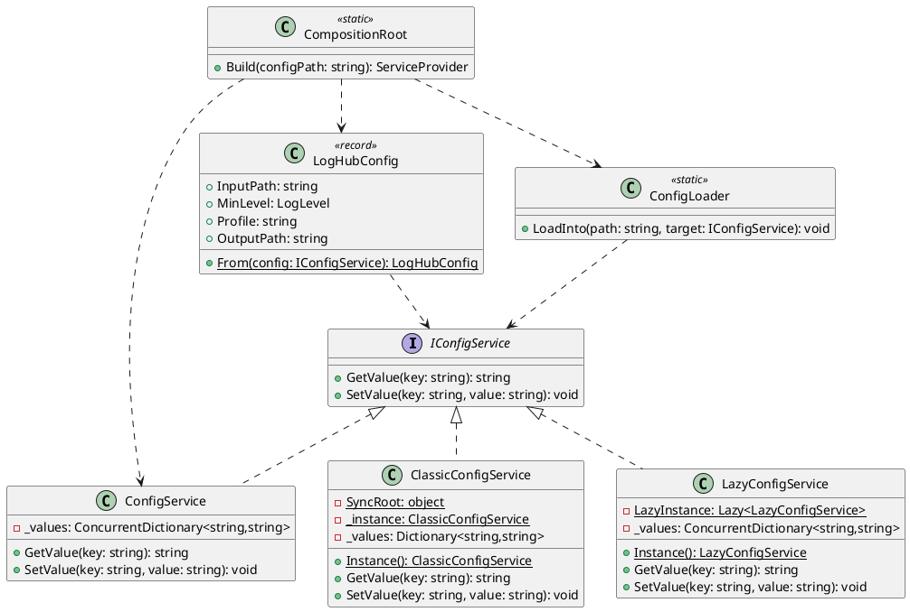
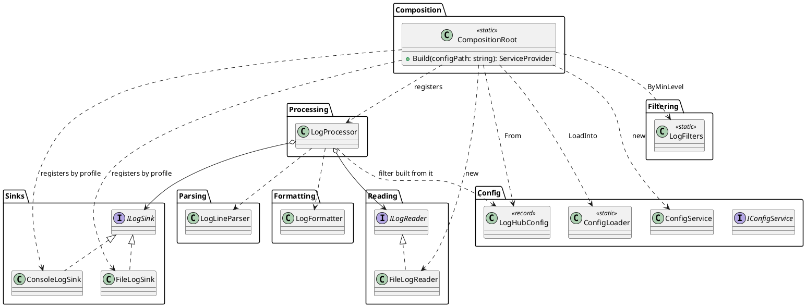

## Задача

В этой работе я разбирался с инверсией управления и внедрением зависимостей на примере собственного конвейера обработки логов из ЛР1. Нужно было сделать четыре вещи. Во-первых, реализовать сервис конфигурации `IConfigService` тремя способами: классическим синглтоном с приватным конструктором и статическим `Instance()`, синглтоном через `Lazy<T>` и обычным классом с публичным конструктором, время жизни которого задаёт DI-контейнер. Во-вторых, главное — воспроизвести на тестах проблему глобального состояния: показать тест, который проходит в одиночку и падает в наборе, и показать, что для контейнерного варианта такого теста не существует в принципе. В-третьих, собрать `LogHub` на `Microsoft.Extensions.DependencyInjection` так, чтобы все зависимости приходили через конструктор, `new` для сервисов встречался только в композиционном корне, а обращение к `IServiceProvider` было ровно одно — в точке входа. В-четвёртых, сделать два профиля конфигурации, `console` и `file`, которые переключаются правкой `config.txt` без перекомпиляции.

Вариант проекта — 17: логи с несколькими кодировками, приёмники «файл» и «консоль». Логику чтения и разбора строк я в этой работе не менял, она осталась такой же, как в ЛР1; работа посвящена сборке объектного графа и управлению временем жизни сервисов.

## Часть 1. Три реализации IConfigService

Контракт из задания минимальный: чтение и запись значения по ключу.

```csharp
namespace LogHub.Config;

public interface IConfigService
{
    string? GetValue(string key);

    void SetValue(string key, string value);
}
```

Классический синглтон хранит единственный экземпляр в статическом поле и закрывает конструктор. Чтобы создание было потокобезопасным, я использовал double-checked locking: внешняя проверка без блокировки, затем `lock` на приватном объекте и повторная проверка. Поле объявлено `volatile`, иначе возможна ситуация, когда другой поток увидит ненулевой адрес раньше, чем закончится инициализация объекта.

```csharp
namespace LogHub.Config;

public sealed class ClassicConfigService : IConfigService
{
    private static readonly object SyncRoot = new();
    private static volatile ClassicConfigService? _instance;

    private readonly Dictionary<string, string> _values = new(StringComparer.OrdinalIgnoreCase);

    private ClassicConfigService()
    {
    }

    public static ClassicConfigService Instance()
    {
        if (_instance is null)
        {
            lock (SyncRoot)
            {
                _instance ??= new ClassicConfigService();
            }
        }

        return _instance;
    }

    public string? GetValue(string key)
    {
        lock (SyncRoot)
        {
            return _values.GetValueOrDefault(key);
        }
    }

    public void SetValue(string key, string value)
    {
        lock (SyncRoot)
        {
            _values[key] = value;
        }
    }
}
```

Вариант с `Lazy<T>` перекладывает синхронизацию создания на стандартный класс. Важно понимать, что `Lazy<T>` решает только проблему гонки при создании экземпляра, но не проблему глобального состояния: сам экземпляр по-прежнему один на весь процесс.

```csharp
using System.Collections.Concurrent;

namespace LogHub.Config;

public sealed class LazyConfigService : IConfigService
{
    private static readonly Lazy<LazyConfigService> LazyInstance = new(() => new LazyConfigService());

    private readonly ConcurrentDictionary<string, string> _values = new(StringComparer.OrdinalIgnoreCase);

    private LazyConfigService()
    {
    }

    public static LazyConfigService Instance() => LazyInstance.Value;

    public string? GetValue(string key) => _values.GetValueOrDefault(key);

    public void SetValue(string key, string value) => _values[key] = value;
}
```

Третий вариант — обычный класс без статики. У него публичный конструктор, собственное хранилище в экземпляре и нет никакой глобальной точки доступа. Единственность экземпляра, если она нужна приложению, обеспечивает контейнер регистрацией `AddSingleton`.

```csharp
using System.Collections.Concurrent;

namespace LogHub.Config;

public sealed class ConfigService : IConfigService
{
    private readonly ConcurrentDictionary<string, string> _values = new(StringComparer.OrdinalIgnoreCase);

    public string? GetValue(string key) => _values.GetValueOrDefault(key);

    public void SetValue(string key, string value) => _values[key] = value;
}
```

Сравнение трёх вариантов:

| Вариант | Как обеспечивается единственность | Где живёт состояние | Тестируемость |
| --- | --- | --- | --- |
| `ClassicConfigService` | Приватный конструктор и статическое поле, доступ только через `Instance()` | В статическом поле типа, на весь процесс | Плохая: состояние переносится между тестами, реализацию нельзя подменить без правки кода |
| `LazyConfigService` | Приватный конструктор и `Lazy<T>` со статическим полем | В статическом поле типа, на весь процесс | Плохая: гонка создания решена, но глобальное состояние осталось |
| `ConfigService` | Внешняя: контейнер создаёт один экземпляр на провайдер | В экземпляре, которым владеет контейнер | Хорошая: каждый тест строит свой провайдер и получает изолированное состояние |

На уровне классов слой конфигурации выглядит так:



`IConfigService` в проекте не является мёртвым демонстрационным кодом. `ConfigLoader.LoadInto` читает файл `key=value` и заполняет сервис через `SetValue`, а `LogHubConfig.From` собирает из сервиса настройки приложения. Поэтому все три реализации проверяются не абстрактно, а на реальном сценарии загрузки конфигурации.

## Часть 2. Проблема синглтона на тестах

Это главный пункт работы, поэтому описываю его подробно. Для классического синглтона я написал два теста в файле `LogHubTests/Config/ClassicConfigServiceTests.cs`. Первый тест по порядку записывает в глобальный синглтон маркер, имитируя «грязное» состояние после предыдущего теста. Второй тест ожидает, что в чистом процессе значение `profile` ещё не задано, то есть равно `null`.

```csharp
[Test]
[Order(1)]
public void SetValue_BeforeOtherTests_LeavesValueInGlobalSingleton()
{
    ClassicConfigService.Instance().SetValue("profile", "corrupted-by-previous-test");

    Assert.That(
        ClassicConfigService.Instance().GetValue("profile"),
        Is.EqualTo("corrupted-by-previous-test"));
}

[Test]
[Order(2)]
[Ignore("Падает при запуске в наборе после SetValue_BeforeOtherTests_LeavesValueInGlobalSingleton: состояние глобального синглтона переносится между тестами. В одиночку (dotnet test --filter \"FullyQualifiedName~GetValue_ProfileInCleanProcess_ReturnsNull\") проходит. Оставлен под Ignore, чтобы CI был зелёным; воспроизведение — снять Ignore и выполнить dotnet test --filter \"FullyQualifiedName~ClassicConfigServiceTests\".")]
public void GetValue_ProfileInCleanProcess_ReturnsNull()
{
    Assert.That(ClassicConfigService.Instance().GetValue("profile"), Is.Null);
}
```

Атрибут `[Order]` гарантирует, что первый тест выполнится раньше второго. Тест с ожиданием `null` помечен `[Ignore]`: в обычном прогоне он не выполняется, иначе CI был бы красным из-за порядка тестов, а не из-за ошибки в коде. В тексте `Ignore` я оставил и причину, и команду воспроизведения.

Чтобы убедиться, что проблема реальна, я временно снял `[Ignore]` и запустил весь класс:

```text
$ dotnet test --filter "FullyQualifiedName~ClassicConfigServiceTests"
  Failed GetValue_ProfileInCleanProcess_ReturnsNull [84 ms]
  Error Message:
     Assert.That(ClassicConfigService.Instance().GetValue("profile"), Is.Null)
  Expected: null
  But was:  "corrupted-by-previous-test"

Failed!  - Failed:     1, Passed:     2, Skipped:     0, Total:     3, Duration: 108 ms
```

Тот же тест, запущенный отдельно, проходит, потому что процесс новый и статическое поле ещё не заполнено:

```text
$ dotnet test --filter "FullyQualifiedName~ClassicConfigServiceTests.GetValue_ProfileInCleanProcess_ReturnsNull"
Passed!  - Failed:     0, Passed:     1, Skipped:     0, Total:     1, Duration: 9 ms
```

[SCREENSHOT: 05_singleton_single_test.png]
Рисунок 1 — Проблемный тест проходит при одиночном запуске по фильтру

[SCREENSHOT: 06_singleton_suite_failure.png]
Рисунок 2 — Тот же тест падает в наборе: синглтон сохранил значение предыдущего теста

Для `LazyConfigService` я сделал такой же набор тестов в файле `LogHubTests/Config/LazyConfigServiceTests.cs` и получил тот же результат. Это важно: `Lazy<T>` устраняет гонку при создании, но не делает состояние локальным для теста. При снятом `[Ignore]` запуск класса даёт:

```text
$ dotnet test --filter "FullyQualifiedName~LazyConfigServiceTests"
  Failed GetValue_ProfileInCleanProcess_ReturnsNull [59 ms]
  Error Message:
     Assert.That(LazyConfigService.Instance().GetValue("profile"), Is.Null)
  Expected: null
  But was:  "corrupted-by-previous-test"

Failed!  - Failed:     1, Passed:     2, Skipped:     0, Total:     3, Duration: 78 ms
```

Одиночный запуск снова зелёный:

```text
$ dotnet test --filter "FullyQualifiedName~LazyConfigServiceTests.GetValue_ProfileInCleanProcess_ReturnsNull"
Passed!  - Failed:     0, Passed:     1, Skipped:     0, Total:     1, Duration: 12 ms
```

Оба проблемных теста возвращены под `[Ignore]`. Полный прогон проекта выглядит так:

```text
$ dotnet test
  Skipped GetValue_ProfileInCleanProcess_ReturnsNull [< 1 ms]
  Skipped GetValue_ProfileInCleanProcess_ReturnsNull [< 1 ms]

Passed!  - Failed:     0, Passed:    32, Skipped:     2, Total:    34, Duration: 247 ms
```

[SCREENSHOT: 07_tests_green.png]
Рисунок 3 — Полный прогон тестов: 32 пройдено, 2 пропущено из-за `[Ignore]`

Почему это вообще происходит. `ClassicConfigService` и `LazyConfigService` хранят словарь в статическом поле типа. Статическое поле живёт столько же, сколько загруженная сборка в процессе тестового раннера. Тестовый раннер запускает все тесты сборки в одном процессе, поэтому тест, выполнившийся раньше, оставляет в этом словаре своё значение. Второй тест уже не может рассчитывать на «чистое» начальное состояние: он видит `"corrupted-by-previous-test"`. В одиночном запуске раннер загружает сборку заново, статика пустая, и тест проходит. Это и есть перенос состояния между тестами, о котором говорится в задании.

## Часть 3. Композиционный корень

Сборку объектного графа я вынес в единственный файл `LogHub/Composition/CompositionRoot.cs`. Только здесь встречается `new` для сервисов приложения: создаётся `ConfigService`, `ServiceCollection`, читается конфигурация и регистрируются зависимости. Остальной код получает зависимости через конструкторы.

```csharp
using LogHub.Config;
using LogHub.Filtering;
using LogHub.Formatting;
using LogHub.Parsing;
using LogHub.Processing;
using LogHub.Reading;
using LogHub.Sinks;
using Microsoft.Extensions.DependencyInjection;

namespace LogHub.Composition;

public static class CompositionRoot
{
    public static ServiceProvider Build(string configPath)
    {
        var configService = new ConfigService();
        ConfigLoader.LoadInto(configPath, configService);
        var config = LogHubConfig.From(configService);

        var services = new ServiceCollection();
        services.AddSingleton<IConfigService>(configService);
        services.AddSingleton(config);
        services.AddSingleton<ILogReader>(_ => new FileLogReader(config.InputPath));
        services.AddSingleton<LogLineParser>();
        services.AddSingleton<LogFormatter>();
        services.AddSingleton<Func<LogEntry, bool>>(_ => LogFilters.ByMinLevel(config.MinLevel));

        switch (config.Profile.ToLowerInvariant())
        {
            case "console":
                services.AddSingleton<ILogSink, ConsoleLogSink>();
                break;
            case "file":
                services.AddSingleton<ILogSink, FileLogSink>();
                break;
            default:
                throw new InvalidOperationException(
                    $"Неизвестный профиль '{config.Profile}'. Ожидается 'console' или 'file'.");
        }

        services.AddSingleton<LogProcessor>();
        return services.BuildServiceProvider();
    }
}
```

Точка входа после миграции стала короткой. Провайдер строится один раз, и обращение к `IServiceProvider` ровно одно — получение готового `LogProcessor`:

```csharp
using LogHub.Composition;
using LogHub.Processing;
using Microsoft.Extensions.DependencyInjection;

var configPath = args.Length > 0 ? args[0] : "config.txt";
using var provider = CompositionRoot.Build(configPath);
var processor = provider.GetRequiredService<LogProcessor>();
var result = processor.Run();
Console.WriteLine($"Обработано: {result.Read}, записано: {result.Written}, пропущено: {result.Skipped}");
```

[SCREENSHOT: 10_composition_root.png]
Рисунок 4 — Композиционный корень: единственное место, где создаются сервисы приложения

Регистрации и времена жизни:

| Сервис | Время жизни | Почему так |
| --- | --- | --- |
| `IConfigService` → `ConfigService` | Singleton | Конфигурация одна на приложение, читается один раз при старте |
| `LogHubConfig` | Singleton | Неизменяемый снимок настроек |
| `ILogReader` → `FileLogReader` | Singleton | Путь к файлу известен заранее, состояние у читателя отсутствует |
| `LogLineParser` | Singleton | Парсер не хранит состояния между строками |
| `LogFormatter` | Singleton | Форматтер не хранит состояния |
| `Func<LogEntry, bool>` | Singleton | Фильтр по минимальному уровню строится из конфигурации один раз |
| `ILogSink` → `ConsoleLogSink` или `FileLogSink` | Singleton | Выбор приёмника определяется профилем при старте |
| `LogProcessor` | Singleton | Собирает остальные зависимости и выполняет один прогон |

Граф зависимостей в композиционном корне:



Почему композиционный корень один и почему Service Locator — антипаттерн. Корень — это место, где приложение собирается из деталей: выбираются реализации, задаются времена жизни, читается конфигурация. Если таких мест несколько, никто не может сказать, какой экземпляр «главный», а singleton-регистрации начинают дублироваться: два независимо построенных провайдера дадут два разных «единственных» экземпляра. Service Locator (`provider.GetService<T>()` где-то в глубине кода) прячет зависимость класса: по его конструктору уже не видно, что ему нужно, а тесту приходится поднимать настоящий контейнер вместо того, чтобы просто передать заглушку. Поэтому зависимости я протягиваю через конструкторы, а `IServiceProvider` трогаю только в `Program.cs`.

`SinkCatalog` из ЛР1 я удалил. Он сканировал сборку через reflection и по имени создавал приёмник, то есть был скрытым сервис-локатором: зависимость `LogProcessor` от конкретного приёмника не была видна в сигнатуре, а выбор происходил в рантайме. Теперь выбор приёмника — это явная регистрация в композиционном корне, а `LogProcessor` по-прежнему зависит только от `IEnumerable<ILogSink>`.

## Часть 4. Профили конфигурации

В `config.txt` строка `sink=console` заменена на `profile=console`. Профиль — это имя набора настроек, а не одного приёмника: сейчас профили различаются приёмником, но позже сюда можно добавить другие параметры.

```text
input=data/sample-utf8.log
minLevel=INFO
profile=console
output=data/out.log
```

| Профиль | Что регистрируется как `ILogSink` | Наблюдаемое поведение |
| --- | --- | --- |
| `console` | `ConsoleLogSink` | Отформатированные строки идут в консоль, итоговая статистика тоже в консоль |
| `file` | `FileLogSink` | Строки дописываются в `data/out.log`, в консоль выводится только итоговая статистика |
| неизвестный | — | `InvalidOperationException` с перечнем допустимых профилей |

Профиль `console` я проверил командой `dotnet run --project LogHub --no-build`:

```text
2026-09-15 10:00:02 [INFO] Сервис запущен
2026-09-15 10:00:03 [INFO] Application started
2026-09-15 10:00:04 [WARN] Низкий запас памяти
...
2026-09-15 10:00:34 [WARN] Кириллица и латиница mixed
2026-09-15 10:00:35 [INFO] Последняя строка файла
Обработано: 35, записано: 24, пропущено: 11
```

[SCREENSHOT: 08_profile_console.png]
Рисунок 5 — Профиль `console`: отформатированные строки выводятся в консоль

Затем я поменял в `config.txt` одну строку на `profile=file`, удалил старый `data/out.log` и запустил приложение той же собранной сборкой с флагом `--no-build`, то есть без перекомпиляции:

```text
$ dotnet run --project LogHub --no-build
Обработано: 35, записано: 24, пропущено: 11

$ wc -l data/out.log
24 data/out.log

$ head -5 data/out.log
2026-09-15 10:00:02 [INFO] Сервис запущен
2026-09-15 10:00:03 [INFO] Application started
2026-09-15 10:00:04 [WARN] Низкий запас памяти
2026-09-15 10:00:05 [ERROR] Не удалось открыть файл
2026-09-15 10:00:06 [INFO] Пользователь вошёл в систему

$ tail -2 data/out.log
2026-09-15 10:00:34 [WARN] Кириллица и латиница mixed
2026-09-15 10:00:35 [INFO] Последняя строка файла
```

[SCREENSHOT: 09_profile_file.png]
Рисунок 6 — Профиль `file`: в консоли только статистика, строки записаны в `data/out.log`

Невалидный профиль даёт понятную ошибку, а не молчаливое падение или пустой вывод:

```text
$ dotnet run --project LogHub --no-build -- /tmp/invalid-config.txt
Unhandled exception. System.InvalidOperationException: Неизвестный профиль 'telegram'. Ожидается 'console' или 'file'.
   at LogHub.Composition.CompositionRoot.Build(String configPath) in /home/ilya/LogHub/LogHub/Composition/CompositionRoot.cs:line 37
   at Program.<Main>$(String[] args) in /home/ilya/LogHub/LogHub/Program.cs:line 6
```

После проверок я вернул `config.txt` в состояние `profile=console`.

## Ключевые решения

Главный вывод работы — разница между паттерном Singleton и регистрацией `AddSingleton` в контейнере. На первый взгляд оба решения дают одно и то же: один экземпляр сервиса. Но они отвечают на разные вопросы и по-разному влияют на тесты.

Паттерн Singleton отвечает на вопрос «как сделать так, чтобы у класса был ровно один экземпляр и глобальная точка доступа к нему». Единственность обеспечивает сам класс: приватный конструктор, статическое поле, статический метод `Instance()`. Область жизни — процесс. Клиент не получает зависимость, а сам зовёт `ClassicConfigService.Instance()`, поэтому зависимость спрятана внутри метода. Подставить другую реализацию `IConfigService` в такой клиент нельзя: он жёстко привязан к конкретному статическому классу. Сбросить состояние между тестами тоже нельзя, не добавив в production-код специальный метод или не залезая в приватное поле через reflection. Именно это и показано в `ClassicConfigServiceTests`: тест `SetValue_BeforeOtherTests_LeavesValueInGlobalSingleton` оставляет в статическом словаре маркер, а тест `GetValue_ProfileInCleanProcess_ReturnsNull` в наборе видит этот маркер. Пришлось пометить его `[Ignore]`, иначе CI красный. Проблема здесь не в том, что тест «неправильно написан», а в том, что у теста нет границы изоляции: он делит состояние со всеми остальными тестами процесса.

`LazyConfigService` это не лечит. `Lazy<T>` — правильный способ безопасно создать единственный экземпляр, но он не меняет природу этого экземпляра: поле по-прежнему статическое, доступ по-прежнему через `Instance()`. В `LazyConfigServiceTests` падение точно такое же, потому что `Lazy<T>` убирает гонку инициализации, а не глобальность состояния.

Регистрация `AddSingleton<IConfigService, ConfigService>()` отвечает на другой вопрос: «сколько времени живёт экземпляр, который создаёт контейнер». Здесь класс `ConfigService` ничего не знает о своей единственности: у него публичный конструктор и обычное поле экземпляра. Единственность — это политика конкретного `ServiceProvider`, а не свойство типа. Отсюда следуют важные для тестов вещи. Внутри одного провайдера два resolve возвращают один и тот же объект — это проверяет тест `Resolve_TwiceFromSameProvider_ReturnsSameInstance` в `ContainerConfigServiceTests`. Два разных провайдера дают два разных экземпляра — это `Resolve_FromTwoProviders_ReturnsDifferentInstances`. Каждый тест строит свой `ServiceCollection` и свой провайдер, поэтому получает чистое состояние без всяких статических сбросов — это `GetValue_ProfileInFreshProvider_ReturnsNull` и `SetValue_ThenGetValue_InSameProvider_ReturnsStoredValue`. Наконец, реализацию можно подменить заглушкой на уровне регистрации, и клиент об этом не узнает — это `Resolve_WithFakeRegistration_ReturnsFakeValue` и `ConstructorInjection_WithFake_ReturnsFakeValue_WithoutStaticReset`.

Именно поэтому для контейнерного варианта проблемного теста не существует в принципе. Проблемный тест синглтона опирается на то, что состояние переживает тест. У контейнерного варианта состояние привязано к провайдеру, а провайдер создаётся внутри теста и там же уничтожается (`using var provider`). Нет общего процесса-хранилища — нет и переноса состояния. Изоляция достигается структурно, а не дисциплиной «не забудь сбросить статику».

Второе важное отличие — направление зависимости. При паттерне Singleton высокоуровневый код зависит от конкретного класса и его статического метода, то есть от детали. При внедрении через конструктор он зависит от интерфейса `IConfigService`, а конкретный класс выбирается в композиционном корне. Это и есть инверсия зависимостей: и клиент, и реализация зависят от абстракции, а сборка происходит в одном месте. Паттерн Singleton можно использовать аккуратно, если клиент получает ссылку через конструктор, а не зовёт `Instance()`, но тогда от паттерна остаётся только «один экземпляр», а глобальная точка доступа — как раз то, что ломает тестируемость, — не нужна.

Отдельно отмечу типичную ошибку, которую я сознательно не повторил: зарегистрировать `ConfigService` в контейнере, но в клиентах продолжать писать `ClassicConfigService.Instance()`. В таком случае контейнер не управляет ничем, глобальная точка доступа остаётся, а тесты по-прежнему зависят от порядка выполнения. В моём коде `Instance()` есть только у двух демонстрационных реализаций, а приложение через контейнер использует `ConfigService` с публичным конструктором; в `Program.cs` и `CompositionRoot.cs` нет ни одного вызова `Instance()`.

## Тесты

Всего в проекте 34 теста: 10 из ЛР1 и 24 новых. Из новых два намеренно пропущены через `[Ignore]` — это проблемные тесты классического синглтона и `Lazy<T>`.

| Тест | Что проверяет |
| --- | --- |
| `ConfigServiceTests.GetValue_MissingKey_ReturnsNull` | Обычный класс возвращает `null` для незаданного ключа |
| `ConfigServiceTests.SetValue_ThenGetValue_ReturnsStoredValue` | Запись и чтение значения в одном экземпляре |
| `ConfigServiceTests.SetValue_SameKeyTwice_OverwritesValue` | Повторная запись перезаписывает значение |
| `ConfigServiceTests.GetValue_DifferentKeyCase_IsCaseInsensitive` | Ключи нечувствительны к регистру |
| `ConfigServiceTests.EachTest_OwnInstance_DoesNotSeeStateFromOtherTests` | Новый экземпляр начинает с чистого состояния |
| `ConfigServiceTests.ConstructorInjection_WithFake_ReturnsFakeValue_WithoutStaticReset` | Клиент с внедрённой заглушкой не требует статических сбросов |
| `ClassicConfigServiceTests.Instance_CalledTwice_ReturnsSameReference` | Классический синглтон действительно один |
| `ClassicConfigServiceTests.SetValue_BeforeOtherTests_LeavesValueInGlobalSingleton` | Первый тест оставляет состояние в глобальном синглтоне |
| `ClassicConfigServiceTests.GetValue_ProfileInCleanProcess_ReturnsNull` | В наборе падает из-за состояния, в одиночку проходит; `[Ignore]` |
| `LazyConfigServiceTests.Instance_CalledTwice_ReturnsSameReference` | `Lazy<T>` возвращает один экземпляр |
| `LazyConfigServiceTests.SetValue_BeforeOtherTests_LeavesValueInGlobalSingleton` | Первый тест оставляет состояние в глобальном синглтоне |
| `LazyConfigServiceTests.GetValue_ProfileInCleanProcess_ReturnsNull` | Та же проблема переноса состояния; `[Ignore]` |
| `ContainerConfigServiceTests.GetValue_ProfileInFreshProvider_ReturnsNull` | Свежий провайдер даёт чистое состояние |
| `ContainerConfigServiceTests.SetValue_ThenGetValue_InSameProvider_ReturnsStoredValue` | Состояние живёт внутри провайдера |
| `ContainerConfigServiceTests.Resolve_TwiceFromSameProvider_ReturnsSameInstance` | Семантика `AddSingleton` внутри провайдера |
| `ContainerConfigServiceTests.Resolve_FromTwoProviders_ReturnsDifferentInstances` | Два провайдера — два независимых «синглтона» |
| `ContainerConfigServiceTests.Resolve_WithFakeRegistration_ReturnsFakeValue` | Подмена реализации регистрацией заглушки |
| `LogHubConfigTests.From_AllValuesProvided_ReadsThem` | Все поля читаются из `IConfigService` |
| `LogHubConfigTests.From_ProfileMissing_DefaultsToConsole` | Профиль по умолчанию — `console` |
| `LogHubConfigTests.From_MinLevelMissing_DefaultsToInfo` | Уровень по умолчанию — `INFO` |
| `LogHubConfigTests.From_InputAndOutputMissing_UseSampleDefaults` | Пути по умолчанию совпадают с прежним поведением |
| `CompositionRootTests.Build_ConsoleProfile_RegistersConsoleSink` | Профиль `console` регистрирует `ConsoleLogSink` |
| `CompositionRootTests.Build_FileProfile_RegistersFileSink` | Профиль `file` регистрирует `FileLogSink` |
| `CompositionRootTests.Build_UnknownProfile_ThrowsInvalidOperationException` | Неизвестный профиль даёт понятное исключение |

Тесты ЛР1 сохранены: пять тестов `LogLineParserTests` и пять тестов `LogProcessorTests` по-прежнему проходят. В `LogProcessor` изменился только тип параметра конструктора — `IReadOnlyList<ILogSink>` заменён на `IEnumerable<ILogSink>`, чтобы контейнер мог внедрять коллекцию нативно; внутри конструктора коллекция материализуется в список. Логику тестов я не менял.

```text
$ dotnet build --no-incremental -warnaserror
Build succeeded.
    0 Warning(s)
    0 Error(s)

$ dotnet test
Passed!  - Failed:     0, Passed:    32, Skipped:     2, Total:    34, Duration: 247 ms
```

[SCREENSHOT: 11_ci_green.png]
Рисунок 7 — Зелёный прогон сборки и тестов в GitHub Actions

## Что не получилось

Главное ограничение — проблемные тесты нельзя держать включёнными. Они действительно падают в наборе, и это не баг теста, а воспроизведение проблемы. Поэтому оба теста остаются под `[Ignore]`, а проверка выполняется вручную: снять атрибут, запустить класс, увидеть падение, запустить тест отдельно, увидеть успех, вернуть атрибут. Автоматизировать это в CI без изменения production-кода нельзя: у статического синглтона нет легального способа сбросить состояние между тестами. Добавлять метод `Reset()` в боевой класс я не стал — это значило бы менять дизайн ради теста и маскировать саму проблему.

Ещё один компромисс — невалидный профиль приводит к необработанному `InvalidOperationException` и стектрейсу в консоли. Сообщение понятное и содержит допустимые значения, но для пользователя приложения это выглядит грубо; в реальном продукте я бы перехватил исключение в точке входа и вывел его без стектрейса. В рамках лабораторной я оставил исключение как есть, потому что оно наглядно показывает, что ошибка конфигурации обнаруживается сразу при сборке графа, а не где-то в середине обработки.

Слой чтения логов в этой работе не менялся: конвейер по-прежнему обрабатывает один входной файл, а вся работа сосредоточена на конфигурации, временах жизни и композиционном корне. Автоопределение кодировки варианта 17 относится к слою импорта и в объём этой лабораторной не входило.

## Источники

1. Практикум, лабораторная работа 5 «IoC, DI-контейнер и Синглтон».
2. Материалы лекции №3: IoC, внедрение зависимостей, композиционный корень, времена жизни.
3. Глава «Singleton» учебника.
4. Глава «SOLID» учебника, раздел про принцип инверсии зависимостей.
5. Документация Microsoft: `Microsoft.Extensions.DependencyInjection`, времена жизни сервисов и валидация областей.

## Контрольные вопросы

1. **Почему двойная проверка блокировки без `volatile` — ошибка?** Классическая реализация сначала проверяет статическое поле без блокировки, затем берёт `lock` и проверяет ещё раз. Без `volatile` компилятор и процессор могут переставить запись ссылки в поле раньше, чем закончится выполнение конструктора. Другой поток, который читает поле снаружи блокировки, увидит ненулевую ссылку и решит, что экземпляр готов, хотя часть полей ещё не проинициализирована. `volatile` запрещает такие перестановки и гарантирует видимость записи для других потоков. В `ClassicConfigService` поле объявлено `volatile`, а доступ к словарю идёт под тем же `SyncRoot`.

2. **Почему `lock(this)` — плохая практика?** Потому что объект, на котором висит блокировка, доступен снаружи. Любой внешний код может сделать `lock(sameObject)` и либо надолго остановить ваш класс, либо устроить взаимную блокировку. Вы не контролируете, кто ещё синхронизируется на этом же объекте. По той же причине не стоит блокироваться на `typeof(T)` и на строковых литералах: они тоже общие для процесса. Правильно держать отдельный приватный объект, как `private static readonly object SyncRoot = new();` в `ClassicConfigService`.

3. **Что такое композиционный корень и почему он должен быть один?** Это место в точке входа, где создаются конкретные реализации, читается конфигурация и собирается объектный граф. Остальной код не знает, откуда взялись зависимости: он получает их через конструкторы. Корень должен быть один, потому что иначе появляются несколько независимых графов и несколько «единственных» экземпляров. Например, два вызова `BuildServiceProvider` создадут два `ConfigService`, и оба будут считать себя единственными. Кроме того, при нескольких корнях непонятно, кто отвечает за времена жизни и освобождение ресурсов. В моём проекте корень — `LogHub/Composition/CompositionRoot.cs`, а `Program.cs` только вызывает его и один раз получает `LogProcessor`.

4. **Три времени жизни в DI-контейнере — в чём разница и когда какое?** `Singleton` создаёт один экземпляр на провайдер и отдаёт его всем, кто просит. `Scoped` создаёт один экземпляр на область (scope); в веб-приложении scope обычно совпадает с HTTP-запросом. `Transient` создаёт новый экземпляр на каждый resolve. Singleton подходит для конфигурации, кэшей и stateless-сервисов. Scoped — для состояния, которое должно жить в пределах запроса или единицы работы, например `DbContext`. Transient — для лёгких объектов без состояния, которые не жалко создавать часто. В `LogHub` весь граф — singleton, потому что приложение консольное и делает один прогон; scope и transient здесь не нужны. Если бы приложение обрабатывало несколько независимых заданий, процессор и читатель я бы сделал scoped.

5. **Что такое захваченная зависимость (captive dependency) и как её поймать?** Это когда долгоживущий сервис в конструкторе получает короткоживущую зависимость и держит её у себя дольше, чем она должна жить. Самый частый случай — singleton зависит от scoped: scope-объект создаётся один раз вместе с singleton и переиспользуется всеми, хотя предполагалось создавать его на каждый запрос. Поймать можно валидацией: включить `ValidateScopes` и `ValidateOnBuild` при построении провайдера (в ASP.NET Core это делается автоматически в среде разработки). Эти проверки падают при попытке singleton-сервиса получить scoped-зависимость. Дополнительно помогает ревизия времён жизни по таблице регистраций и тест, который строит провайдер с валидацией. В моём графе все регистрации singleton, поэтому захваченных зависимостей нет, но при добавлении scoped-сервисов я бы включил валидацию.

6. **Слайд про DIP называет синглтон нарушением этого принципа. Всегда ли это так?** Не всегда. Нарушает не сама единственность экземпляра, а глобальная точка доступа и зависимость от конкретного класса. Если класс с единственным экземпляром внедряется через интерфейс в конструктор, клиент зависит от абстракции, и DIP соблюдён. Если же клиент вызывает `ConfigService.Instance()`, он зависит от конкретного статического класса, и подменить реализацию нельзя — это нарушение. Поэтому в приложении я использую `ConfigService` с публичным конструктором и регистрацией `AddSingleton`, а классический синглтон оставил только как учебный пример, демонстрирующий проблему.

7. **Чем внедрение через конструктор лучше внедрения через свойство?** Конструктор делает зависимости обязательными и явными: объект нельзя создать в недопустимом состоянии, все поля можно сделать `readonly`, а список зависимостей виден в сигнатуре. Компилятор и контейнер проверяют, что всё передано. Внедрение через свойство оставляет объект частично инициализированным, зависимость можно забыть установить и получить `NullReferenceException` в рантайме; кроме того, свойство можно менять после создания, что усложняет жизненный цикл. Внедрение через свойство оправдано только для необязательных зависимостей или когда объект создаёт не контейнер, а инфраструктура (например, элементы UI). В `LogHub` все зависимости идут через конструктор.

8. **Конструктор на десять параметров — это проблема DI или что-то другое?** Это проблема дизайна класса, а не контейнера. DI лишь делает её видимой: если конструктор разросся, значит, у класса слишком много причин для изменения и низкая связность. Контейнер может технически передать десять зависимостей, но это не сделает класс проще. Лечить нужно выделением новых ответственностей: разбить класс на несколько, вынести часть поведения в отдельный сервис или фасад. В `LogProcessor` пять зависимостей, и это близко к верхней границе разумного; если бы добавились шестая и седьмая, я бы сначала искал, какую ответственность из процессора можно вынести, а не расширял конструктор.
